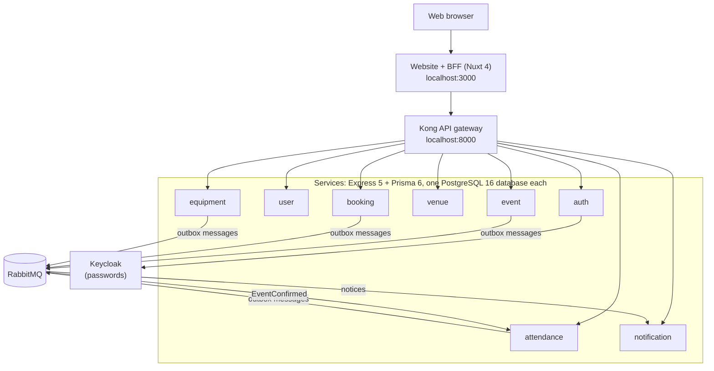

# ConnectSphere

ConnectSphere is the event planning and venue booking system for ConnectSphere Event Services. It was built for IS212 Software Project Management, AY2026/27 T1, Section G8.

**Repository:** https://github.com/aryan12singh/connectsphere

This README is written for someone joining the team. It explains what the system does, how the code is organised, how to run it, and how to test and change it safely. Each section links to the detailed document when you need more.

## Contents

1. [What the system does](#1-what-the-system-does)
2. [Architecture](#2-architecture)
3. [Repository layout](#3-repository-layout)
4. [Run it locally](#4-run-it-locally)
5. [Accounts and local addresses](#5-accounts-and-local-addresses)
6. [Tests](#6-tests)
7. [Playwright browser tests and where their results go](#7-playwright-browser-tests-and-where-their-results-go)
8. [How we work: CI, pull requests and Definition of Done](#8-how-we-work-ci-pull-requests-and-definition-of-done)
9. [Conventions](#9-conventions)
10. [Troubleshooting](#10-troubleshooting)
11. [Documentation map](#11-documentation-map)
12. [Course deliverables](#12-course-deliverables)

## 1. What the system does

Release 1 covers the 20 core features from the Week 4 project instructions and the six Week 7 customer changes. An event goes through this journey:

1. **Request.** An Organiser saves a draft request and submits it. An Event Coordinator Lead assigns a Coordinator.
2. **Review.** The Coordinator approves, rejects or returns the request for amendment. Approval creates the Event in **Planning**.
3. **Arrangements.**
   - **Venues:** the Coordinator books one or more venues with expiring tentative holds, and Venue Staff approve them. Setup and turnaround buffers prevent overlaps. Venues can be marked unavailable and replaced.
   - **Equipment:** the Coordinator records equipment and support needs, and Technical Support approves and reserves stock.
4. **Safety.** A Safety Officer reviews the arrangements. They approve, request changes or reject the venue arrangement, and rework repeats in numbered rounds.
5. **Confirmation and preparation.** The Coordinator confirms the Event, then starts Preparation. The Event completes automatically after it ends.
6. **Attendees.** Attendees register within the Organiser's rules and can withdraw.
7. **Changes and cancellation.** Changes are proposed and approved or rejected. Cancellation releases every venue and equipment commitment.
8. **Notifications.** Everyone affected gets in-app notices (the bell icon).

There are seven roles. Each one lands on its own page after signing in:

| Role | Lands on | Main jobs |
|---|---|---|
| Event Organiser | `/` Your events | Submit requests, propose changes, request cancellation, set withdrawal rules |
| Event Coordinator | `/` Review queue | Review requests, book venues, record technical needs, send for Safety, confirm, cancel |
| Event Coordinator Lead | `/queue` | Assign and reassign Coordinators, oversee active Events |
| Venue Staff | `/venue` | Maintain venues and buffers, approve bookings, mark venues unavailable |
| Technical Support Staff | `/technical-requirements` | Approve and reserve equipment, manage stock, administer users through the admin API |
| Safety Officer | `/safety-checks` | Run the operational Safety check |
| Attendee | `/attendances` | See confirmed Events, register and withdraw |

## 2. Architecture



- **Frontend:** Nuxt 4, Vue 3 and TypeScript. The browser only talks to Nuxt's own server routes (the BFF in `frontend/server`), which keep the session in a sealed, HTTP-only cookie and call the backend through Kong.
- **Gateway and identity:** Kong 3.6 routes the public APIs. Keycloak 26 stores passwords, and auth-service turns a successful Keycloak check into its own session.
- **Services:** eight services, one per business area, each in plain JavaScript with its **own** PostgreSQL database. A service never reads another service's database. Services call each other only through private `/internal` APIs, which Kong does not expose.
- **Messaging:** a service that changes something important writes a message to its outbox table in the same transaction. A relay then publishes it to RabbitMQ (exchange `connectsphere.events`). notification-service turns messages into notices, deduplicating them, and attendance-service uses `EventConfirmed` to publish Events to Attendees.

More detail: [architecture overview](docs/architecture/connectsphere-architecture.md), [API contract](docs/architecture/api-contract.md) and [access matrix](docs/architecture/access-matrix.md).

## 3. Repository layout

```text
connectsphere/
├── frontend/                 Nuxt website and its BFF
│   ├── app/                  pages, components, composables, middleware (route guards)
│   ├── server/               BFF API routes the browser calls (/api/...), which forward to Kong
│   └── e2e/                  Playwright live browser journeys, one file per story (CS-xx.spec.ts)
├── services/
│   ├── <name>-service/       auth, user, event, venue, booking, equipment, attendance, notification
│   │   ├── src/              Express app: routes/, domain rules, outbox relay
│   │   ├── prisma/           schema.prisma, migrations/ and seed/ SQL for this service's database
│   │   ├── tests/            unit, integration (PostgreSQL) and HTTP contract tests
│   │   └── swagger.html or docs/openapi.yaml   this service's API reference
│   └── utils/                shared code: outbox relay, message bus, role policy
├── gateway/kong/             Kong routes (kong.yml)
├── infra/                    Docker Compose stack, Keycloak realm, PostgreSQL init and seed runner
├── scripts/                  isolated live-stack runner used by CI and for local Playwright runs
├── tests/
│   ├── specs/                Vitest frontend tests: pages, components and BFF routes (CS-xx.spec.ts)
│   ├── helpers/              shared test fixtures and harnesses
│   ├── scripts/              test runners, coverage gates, traceability generator
│   └── records/CS-xx/        each story's test case specification and dated test runs
├── docs/                     guides, architecture, decisions, testing, process, sprint notes, dev log (see docs/README.md)
├── .github/workflows/        the CI pipeline
└── .agents/skills/           team guidance for AI coding assistants (frontend conventions, TDD, test alignment)
```

**Two folders of `.spec.ts` files.** `tests/specs` and `frontend/e2e` share story names, but they are different test layers, not duplicates.

| | `tests/specs` | `frontend/e2e` |
|---|---|---|
| Tool | Vitest | Playwright |
| What runs | One page, component or BFF route, with its neighbours stubbed | The real website in a real browser, against the whole stack (every service, Kong, Keycloak, RabbitMQ, PostgreSQL) |
| Speed | Seconds, no browser | Minutes, fresh stack per run |
| Good for | Every branch, error and boundary of one screen or route | Full user journeys across services, desktop and mobile |
| CI job | **Frontend** | **Live browser journeys (shard 1/4 to 4/4)** |

Their paths are referenced by `frontend/vitest.config.ts`, `frontend/playwright.config.ts`, the CI workflow and the traceability scripts, so don't move them without updating all four.

## 4. Run it locally

**You need:**
- Docker Desktop
- Node.js 22. `.nvmrc` pins it, so `nvm use` picks it up.
- Git

**Windows:**
- Clone **outside OneDrive**, because it locks files during `npm ci`.
- Run this once, so npm scripts that use Bash work: `npm config set script-shell "C:\Program Files\Git\bin\bash.exe"`

```bash
git clone https://github.com/aryan12singh/connectsphere.git
cd connectsphere

# 1. Backend: PostgreSQL, Keycloak, Kong, RabbitMQ and every service.
#    The first build takes 10-20 minutes.
docker compose -f infra/docker-compose.yml up --build -d

# 2. After every --build, wait about a minute, then restart Kong.
#    Otherwise sign-in fails with 502.
docker compose -f infra/docker-compose.yml restart kong

# 3. Seed data. Safe to run again.
docker compose -f infra/docker-compose.yml run --rm seed

# 4. Website
cd frontend
npm ci
cp .env.example .env        # Windows cmd: copy .env.example .env
npm run dev                 # open http://localhost:3000
```

**Day to day:**

| To… | Run |
|---|---|
| Stop | Press Ctrl+C in the website terminal, then `docker compose -f infra/docker-compose.yml stop` |
| Continue, keeping data | `docker compose -f infra/docker-compose.yml up -d`, then `restart kong`, then `npm run dev` |
| After pulling new code | `up --build -d`, then `restart kong`, then `run --rm seed`, then `npm ci` (each service applies its new migrations on start) |
| Reset everything | `docker compose -f infra/docker-compose.yml down -v`, then the steps above. This deletes all local data. |

The full step-by-step guide, including manual test cases, is [docs/guides/how-to-run-and-test.md](docs/guides/how-to-run-and-test.md).

## 5. Accounts and local addresses

Every seeded account has its own password. The full list is in [how to run and test](docs/guides/how-to-run-and-test.md#seed-users-live-mode) and in `infra/keycloak/connectsphere-realm.json`. One account per role:

| Role | Email | Password |
|---|---|---|
| Event Organiser | sarah.tan@nexuslabs.sg | Sarah@CS01! |
| Event Coordinator | aisha.rahman@connectsphere.sg | Aisha@CS05! |
| Event Coordinator Lead | jordan.lim@connectsphere.sg | Jordan@CS32! |
| Venue Staff | ravi.kumar@marinaconvention.sg | Ravi@CS08! |
| Technical Support Staff | hafiz.ismail@connectsphere.sg | Hafiz@CS11! |
| Safety Officer | alex.chen@connectsphere.sg | Alex@CS31! |
| Attendee | ethan.goh@gmail.com | Ethan@CS13! |
| Organiser + Attendee (role switching) | priya.raman@greenleaf.org.sg | Priya@CS03! |

These are development-only credentials for local data.

| Address | What |
|---|---|
| http://localhost:3000 | The website |
| http://localhost:8000 | Kong (the API the BFF calls) |
| http://localhost:3002/docs | auth-service Swagger UI. The admin API is used by Technical Support. |
| http://localhost:8080 | Keycloak admin (admin / admin) |
| http://localhost:15672 | RabbitMQ management (connectsphere / connectsphere-dev-only) |
| http://localhost:5050 | pgAdmin (admin@connectsphere.dev / admin). Server host `postgres`, user and password `connectsphere`. |

## 6. Tests

Tests run at four layers, and most stories have tests in more than one:

| Layer | Where | Runner | Proves |
|---|---|---|---|
| Service unit and HTTP contract | `services/<service>/tests/unit` (auth and user: `tests/*.test.js`), plus `tests/test_*.py` contract tests | `node --test`, Python `unittest` | Business rules, validation, permissions and each service's API contract |
| Service integration | `services/<service>/tests/integration` | `node --test` against the service's own `<service>_test` database | Real migrations, transactions, locking, outbox and concurrency |
| Frontend unit, component and BFF | `tests/specs` | Vitest | Pages show the right states; BFF routes enforce access |
| Live end-to-end | `frontend/e2e` | Playwright, desktop and mobile | Full journeys through the real stack, including restarts |

**Running them:**

```bash
# One service (from services/<service>/). Integration tests refuse any database other than <service>_test.
npm ci
npx prisma generate
npm run test:coverage        # unit tests with the coverage floor
npm run test:integration     # set DATABASE_URL to the <service>_test database and run `npx prisma migrate deploy` first
npm run test:contract        # venue, booking, event and notification

# Frontend (from frontend/)
npm ci
npm run typecheck
npm run typecheck:e2e
NUXT_AUTH_MODE=mock npm run test:coverage
```

**Where tests and records live:**
- **Mapping stories to tests:** the [test traceability index](docs/testing/test-traceability.md) maps every story to its specified cases (`TC-CSnn-xx`) and to each test file that names them. It is generated, so after adding or renaming tests run `node tests/scripts/traceability-index.mjs`.
- **Story records:** each story's case specification and dated runs are in [tests/records](tests/records/README.md).
- **Coverage:** floors are in the [coverage policy](docs/testing/coverage-policy.md). A run below its floor fails.

## 7. Playwright browser tests and where their results go

Playwright is configured in `frontend/playwright.config.ts`. It runs the `frontend/e2e` journeys in two browser setups, `desktop` (Chrome) and `mobile` (Pixel 7), with one worker and no retries. The journeys need a freshly seeded stack, so they are normally run through the isolated runner, not against your everyday stack.

**Run them locally** (Linux, macOS or WSL, with Node 22). This builds a separate throw-away stack on its own ports, runs the browser tests, and removes the stack afterwards.

First install the locked dependencies the runner uses: `npm ci` in `frontend/` and in each service, then `npx playwright install chromium` in `frontend/`. The [isolated live review guide](docs/guides/event-review-run.md) has the exact commands. Then:

```bash
CSE2E_PROJECT=csreview-aryan-ci-local-$(date +%s) \
CSE2E_WORK_DIR=$HOME/cs-e2e-$(date +%s) \
CSE2E_STAGE=browser \
CSE2E_BROWSER_ARGS="--project=desktop e2e/CS-10.spec.ts" \
bash scripts/run-event-review-ci.sh
```

- To watch the browser, add `--headed` to `CSE2E_BROWSER_ARGS`.
- To run every story on both browser setups, leave `CSE2E_BROWSER_ARGS` out.
- Full options: [isolated live review](docs/guides/event-review-run.md).

**Where the results go:**

| Run | Results folder | Kept in Git? |
|---|---|---|
| `npm run test:e2e:report` (from `frontend/`) | `frontend/test-results/e2e/` (or `$CSE2E_EVIDENCE_DIR`) | No, the folder is in `.gitignore` |
| The isolated runner above | `$CSE2E_WORK_DIR/evidence/` | No |
| CI | Artifacts **live-browser-evidence-1** to **-4** and **live-integration-evidence** on the workflow run, kept for 30 days | No |

Each results folder contains:
- `html/index.html`: the Playwright HTML report. Open it in a browser, search by story (`CS-88`) or case (`TC-CS90-01`).
- `results.json`: machine-readable results.
- `screenshots/`: screenshots of failures only.
- `story-records/CS-xx/<time>-BROWSER.md`: one dated Markdown record per story.
- `source.json`: the code revision that was tested.
- `services.log`: service logs (runner and CI only).

Playwright results are **not** written into `tests/` automatically. `tests/records/CS-xx/test-runs/` holds the dated records the team chose to keep: they copy a `story-records` file there and commit it with the evidence link. This keeps large reports and screenshots out of Git while the written record stays reviewable.

## 8. How we work: CI, pull requests and Definition of Done

- **Branches and PRs:** work on a branch and open a pull request into `main`. Changes reach `main` only through a reviewed, squash-merged PR with green checks.
- **CI** ([workflow](.github/workflows/event-workflows.yml)) runs on every PR and on pushes to `main`:
  - **Frontend**, and one job per service, each with real PostgreSQL migrations and coverage floors.
  - **Live stack integration and restart:** a fresh full stack, message-bus, Safety and maintenance checks, and a restart without reseeding.
  - **Live browser journeys (shard 1/4 to 4/4):** the Playwright suite split across four fresh stacks.
  - **Required checks:** the single check branch protection requires. It fails if any job failed, was skipped or was cancelled.
- **Definition of Done:** a story is Done only when its acceptance criteria are verified by someone else, tests pass at the right layers, the PR is reviewed, CI is green on the merge commit, and documentation is updated. See [Definition of Done](docs/process/DEFINITION_OF_DONE.md).
- **Development log:** record progress, decisions and blockers in [docs/devlogs/DEVLOG.md](docs/devlogs/DEVLOG.md). Put new entries at the top of "Entries".

## 9. Conventions

- **Story and test IDs:**
  - Stories follow Jira: `CS-nn`, with acceptance criteria `AC1`, `AC2` and so on.
  - Test cases are `TC-CSnn-xx` and appear in test names, so `git grep TC-CS90-01` finds the code that proves a case.
  - Test files are named after their story (`CS-nn.spec.ts`).
- **Backend:**
  - Plain JavaScript (CommonJS), Express 5 and Prisma 6, with simple, commented code.
  - Permission checks (`requirePermission('area.action')`) plus fixed role rules in `services/utils/role-policy.js`.
  - Every important change writes an activity record and an outbox message in the same transaction.
  - Generic error messages go to the user; details go to the logs.
- **Database changes:** change `prisma/schema.prisma` **and** add a new migration (`npx prisma migrate dev --name <change>`). Never edit a migration that has already been merged: other people's databases have already applied it.
- **Frontend:** TypeScript, single quotes, no semicolons. shadcn-vue components. The browser only calls `/api/*` BFF routes.
- **Time:** stored in UTC, and shown in the Event's or venue's time zone (default Asia/Singapore).
- **Secrets:** never commit `.env` files. The passwords in this repository are local development fixtures.

## 10. Troubleshooting

| Symptom | Fix |
|---|---|
| Sign-in fails with 502 | `docker compose -f infra/docker-compose.yml restart kong` |
| Every sign-in says "Invalid credentials" | Run the seed. Check that `frontend/.env` has `NUXT_AUTH_MODE=live`. |
| One seeded staff account can't sign in (for example Jordan or Alex) | Your Keycloak data predates that account. Partial-import `infra/keycloak/connectsphere-realm.json` (Users, skip existing) in Keycloak, or reset with `down -v`. |
| Sign-in fails with 500 "Empty password" | Delete the empty `NUXT_SESSION_PASSWORD=` line in `frontend/.env`. |
| A service returns 500 and its log shows `P2022` | That database is older than the code. Rebuild with `up --build -d`. If needed, recreate only that service's database and re-seed. |
| A page doesn't show another user's latest action | Reload with Ctrl+F5. Pages refresh after your own actions, not other people's. |

More: [how to run and test, Part E](docs/guides/how-to-run-and-test.md).

## 11. Documentation map

All documents are listed in [docs/README.md](docs/README.md). The most useful ones:

- **Running:** [how to run and test](docs/guides/how-to-run-and-test.md) and [isolated live review](docs/guides/event-review-run.md).
- **Design:**
  - [Architecture](docs/architecture/connectsphere-architecture.md), [API contract](docs/architecture/api-contract.md) and [access matrix](docs/architecture/access-matrix.md).
  - [Event workflows](docs/architecture/event-workflows.md), [venue data model](docs/architecture/venue-data-model.md) and [Safety UI](docs/architecture/safety-ui.md).
  - [Service integration and RabbitMQ contract](docs/sprints/sprint3/integration-handoff.md).
- **Decisions:** [customer and PO decisions](docs/decisions/session3-decisions.md), [event workflow decisions](docs/decisions/event-workflow-decisions.md), [venue policy decisions](docs/decisions/venue-policy-decisions.md) and [hold expiry](docs/decisions/hold-expiry.md).
- **Testing:** [test layers](tests/README.md), [traceability](docs/testing/test-traceability.md), [coverage policy](docs/testing/coverage-policy.md) and [story records](tests/records/README.md).

## 12. Course deliverables

The Week 12 submission is a zip with numbered folders. This repository supplies folders 6 and 7, and the in-repo evidence for folders 2 and 3:

| Folder | Deliverable | Where |
|---|---|---|
| 1 | Final product backlog | Jira export (in the zip) |
| 2 | System design (C4) | C4 diagrams in the zip. Supporting design: [architecture](docs/architecture/connectsphere-architecture.md), the service schemas (`services/<service>/prisma/schema.prisma`), the [API contract](docs/architecture/api-contract.md) and the [decision records](docs/decisions). |
| 3 | Test cases and traceability | [Test traceability](docs/testing/test-traceability.md), [tests/records](tests/records/README.md) and the Sprint test sheets |
| 4 | Sprint meeting evidence | In the zip (boards, burndowns, retros, final-sprint recordings) |
| 5 | Slide deck | In the zip (course template) |
| 6 | Code, README, tests and CI | This repository |
| 7 | README with repository link | This file |
