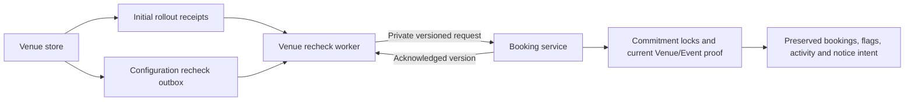
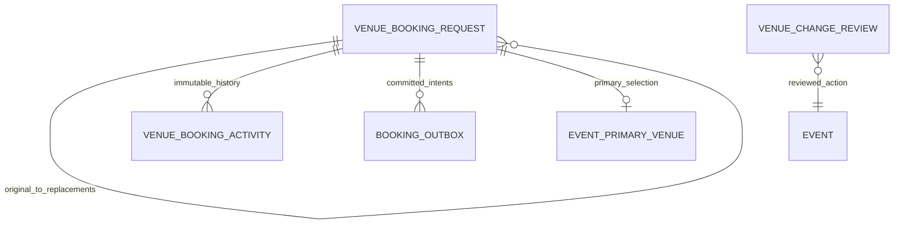

# Venue and booking model

Updated 17 October 2026 on `feat/aryan-sprint3-venue-safety`, after integrating main `52687d2` and the subsequent PO buffer clarification. Schemas and additive migrations below are the implementation source of truth. The files under `docs/erd` remain historical logical drafts. CS-74 still requires another developer's review; CS-77 owns the reviewed cross-service contract.

## Authoritative schemas

| Owner / database | Tables and new metadata | Additive migration |
| --- | --- | --- |
| Venue / `venue_db` | `venues`: setup/turnaround whole minutes and positive version; operating hours and immutable history; `venue_recheck_outbox` with unique venue/version intent, attempts and acknowledgement | [Buffers](../services/venue-service/prisma/migrations/20261012190000_venue_buffers/migration.sql), [durable rechecks](../services/venue-service/prisma/migrations/20261012194500_durable_venue_rechecks/migration.sql) |
| Booking / `booking_db` | Independent `venue_booking_requests`: version, expiry, per-room attendance/layout/needs, required marker, requirements fingerprint, immutable original-request fingerprint, venue version, buffer/window snapshot and conflict flags; activity ledger; `booking_outbox` with unique action key | [Checked holds and intent](../services/booking-service/prisma/migrations/20261012193000_checked_venue_holds/migration.sql) |
| Venue initial rollout / `venue_db` | `venue_buffer_rollouts`: unique local Venue receipt, captured version/intent, attempts/error, completion time/reason; cascades only when its local Venue is legitimately deleted | [Initial rollout](../services/venue-service/prisma/migrations/20261013204500_initial_buffer_rollout/migration.sql) |
| Venue legacy configuration / `venue_db` | `venues.legacyBufferConfigurationPending`: one initial configuration opportunity for venues that existed at the original policy freeze; authenticated Staff communication attestation in immutable Venue history; normal recheck outbox retained | [Coordinated legacy buffers](../services/venue-service/prisma/migrations/20261014161000_coordinated_legacy_buffers/migration.sql) |

Full definitions: [Venue schema](../services/venue-service/prisma/schema.prisma), [Booking schema](../services/booking-service/prisma/schema.prisma).

Venue, Event, manager and human actor UUID text identifiers are logical cross-service references, without cross-database foreign keys. Automated rollout uses an explicit service actor rather than impersonating a user. Local history/hour/outbox/rollout relationships remain in their owning database. Event service supplies the actual Event ID, Planning state, current Coordinator and requirements through its guarded, read-only planning-context route. Booking never reads `event_db` directly. The projection maps the existing form's known layout/accessibility labels to catalogue codes; unknown needs remain unmet.

## Persistence and concurrency

- Venue defaults existing buffers to zero and version to one. Existing IDs, hours and history are preserved. Venue and hours changes lock the Venue row, check a supplied version, increment it, and save history plus recheck intent in one transaction.
- Booking migration preserves IDs/statuses/history and records legacy advertised intervals as zero-buffer windows. Legacy tentative rows receive `min(createdAt + 72h, requestedStart)`; already elapsed deadlines are immediately ineffective. This migration uses the provisional 72-hour treatment; later new holds use configurable policy.
- Booking writes acquire ordered transaction-scoped PostgreSQL advisory locks for the Event and affected venues. They reread current records and use `clock_timestamp()` after waits and slow upstream checks. Successful changes save the booking, activity and unique outbox intent atomically. A failed intent insert rolls all three back.
- New ordinary requests are tentative holds. Staff decisions and extensions require the read version and a reason; stale or expired attempts have no effect. Ordinary creation cannot directly confirm a booking, including for a caller with both Coordinator and Venue Staff roles.
- Venue deletion is serialized through Booking's venue lock. It checks effective current/future tentative and confirmed occupied windows, then invokes Venue's private deletion endpoint with the checked configuration version while retaining the lock. Venue checks that version under its configuration row lock; concurrent buffer changes return409 for refresh/retry. Dependency failure fails closed. Historical rejected/cancelled and fully ended confirmed bookings remain readable after catalogue removal. Only an authorized unapproved move may tolerate a missing retired origin; destination checks remain strict.
- Venue configuration changes retain existing commitments. A durable private recheck retries unavailable Booking service and updates current timing/flags/history without cancelling an Event or another booking. Acknowledgement requires at least the source Venue version. This is eventual synchronization across databases; search, request, decision and readiness also check current Venue configuration.

No database exclusion constraint is claimed. Guarded writes supply conflict protection while permitting required operational closures and inherited conflict flags. Recheck/removal control routes under `/internal` are not routed through Kong. Catalogue/record proof routes also require the shared internal key; their `/venues` prefix does not itself confer public access.

## Current conflict and history projections

Initial buffer rollout is automatic after migration/server startup. Each poll
discovers at most100 legacy/imported venues under row locks with SKIP LOCKED,
persisting one receipt per Venue before any remote request. Configuration and
rollout queues share bounded20-action processing; lower-attempt work is considered
first so a failing dependency cannot starve later healthy venues. Failed intents
retain their action ID and retry after restart. Completion needs Booking's
acknowledgement of the captured or a newer version; it is not inbox delivery.

A newly created API Venue has a new random ID and no inherited commitments. Its
creation transaction records `NEW_VENUE_NO_INHERITED_COMMITMENTS` with zero attempts,
avoiding an extra rollout request beside its first configuration-change action.
Legacy/imported venues receive `BOOKING_ACKNOWLEDGED` only after the real recheck.
No startup pass rewrites Venue settings/history, deletes bookings, or changes the
Event lifecycle. The explicit service actor is `venue-buffer-rollout` / `SYSTEM`;
it grants no user role. Completed receipts prevent replay after restart.

Baseline consultation review: the authoritative Venue schema retains catalogue
type, capacity/layout/facilities/accessibility, local operating hours/timezone,
manager references and immutable local history. Calendar/operational commitments
remain in Booking; overlap and removal use current guarded interfaces. Week 7
buffer/version/hold/independent-room additions are additive and documented above.
No cross-database foreign key or second competing schema is introduced. Another
developer must still review this baseline comparison under CS-74, and CS-77 owns
the cross-service design review.

Venue Staff can read `/venue-bookings/conflicts` and explicitly recheck current
settings through `/venue-bookings/rechecks` with the read Venue version and a reason.
The authenticated actor owns the immutable activity; clients cannot supply another
actor. Current setup/turnaround windows determine both conflict panes and recheck
inclusion, including the period after advertised end but before turnaround ends.
Slow upstream reads finish before the final deadline projection. No read mutates
booking, history or outbox. Missing legacy Events are flagged without inventing an
Event or Coordinator; ordinary decisions still require authoritative Event proof.

Venue-specific history uses immutable before/after venue IDs. A move appears in
both involved timelines; creation remains at its origin. Snapshotless imported
activity is anchored to the earliest available immutable snapshot, with the current
venue retained only when no snapshot exists. The original activity payload is never
rewritten. The existing current-assignment booking-ID filter still protects history.

## Time, suitability and readiness

The occupied interval is advertised start minus Venue setup through advertised end plus turnaround. Operational closures already describe their occupied interval and are not expanded. Search, calendar and guarded writes use the same rule and deadline predicate; expired holds stop blocking immediately without waiting for a worker.

Search compares independent room attendance, parent minimum capacity where applicable, Venue type, layout, explicit facilities, mandatory accessibility and complete occupied-window opening hours. Physical/hybrid capacity is a hard filter: an under-capacity venue is excluded even from partial matches. Full matches sort before eligible partial matches with named gaps for other needs. If none meets hard requirements, return a clear no-results state. Search reserves nothing. Free-text venue notes remain visible for Staff assessment.

All non-cancelled required room arrangements must be approved for the current requirements and free of current suitability/conflict flags for `venueReady`. No capacities are summed and venue readiness does not confirm the parent Event. Physical/hybrid capacity remains positive; virtual capacity/layout may be inapplicable. Opening schedules still reject overnight hours; missing/closed days exclude the occupied interval. Human displays retain IANA timezones and API instants require explicit offsets.

## Current integration and release boundaries

The 17 October branch now implements the real Booking/Event outbox relays, durable RabbitMQ delivery/notification receipts, deadline worker, Officer capabilities, Equipment inventory/coverage/reservations, Event-owned immutable Safety rounds and Preparation. Older main-only or UI-only statements in dated reports remain historical. [Integration handoff](sprint3-integration-handoff.md) records exact contracts, engineering defaults and the resolved Q2 venue-confirmation policy; [architecture](connectsphere-architecture.md) includes the current container/domain/persistence views.

Venue maintenance now persists an owner-side `venues.maintenance` JSON pending fence before Booking checks. Exact-token apply/resume/cancel and an atomic completion hash/receipt guard all catalogue/hour/deletion paths. Booking and Equipment persist their own readiness fences. Current proof cannot advance through an uncertain owner mutation. Additive schemas/migrations in each owning service are authoritative; no cross-database foreign keys are introduced. Only test/evidence tools read multiple databases, never runtime services.

Q2 was resolved on 17 October: Coordinator requests a tentative hold; Staff approval confirms that venue booking with no extra Coordinator action. No schema/state migration is needed; `policy.pendingClarifications` is empty. Parent Event confirmation remains separate. Human model review, peer code review, merge/main CI and manual/PO acceptance remain release gates. Bounded peer integration here does not close another owner's whole story or imply team adoption.

See [BFF routes](frontend-bff-venue-booking.md), [phase delivery and validation](devlogs/2026-10-13-venue-workflows.md), and the existing [Sprint 2 evidence](sprint2/evidence-log.md). This model update does not establish independent review, PO acceptance or story closure.

## Primary attendee location — Session 3 row26

`event_primary_venues` is owned by Booking: one row per Event, a restrictive foreign key to its booking, independent selection version, server actor and update time. The current assigned Coordinator selects an active room in Planning. Event/venue locks serialize selection with booking changes; selection and immutable `PRIMARY_VENUE_SELECTED` history commit atomically. Selection CAS and the read booking version reject stale actions. Other room status/version/approval records are unchanged.

The authenticated Event summary returns `primaryVenue` with booking ID, selection version and derived availability. Missing selection is version0. Release/expiry/flags retain the explicit choice for history but make it unavailable; there is no automatic fallback or cascade. The Attendee-facing Event projection is still a peer integration boundary and must require current confirmed/public lifecycle and an eligible primary room before publication.

## Confirmation buffer fence and one-time legacy configuration — PO clarification, 14 October 2026

Venue owns nullable `buffersLockedAt`. Before a confirmed booking is committed, Booking requests an authenticated internal freeze with the Venue version it validated. The freeze and every buffer edit serialize on the Venue row; the fence increments the Venue version, records the Staff actor in immutable history, and returns the version used by Booking. An edit that wins first makes the freeze stale; a freeze that wins prevents later buffer edits. Unchanged buffers and unrelated venue maintenance remain permitted.

The PO resolved the row4/row6 wording: buffers remain editable before the first confirmed venue booking, then lock. The earlier additive migration conservatively froze existing venues because confirmation history belongs to another service. The [coordinated legacy migration](../services/venue-service/prisma/migrations/20261014161000_coordinated_legacy_buffers/migration.sql) defaults `legacyBufferConfigurationPending` to false and marks it true only for locked Venue rows whose `createdAt` is at or before the recorded successful completion time of `20261014043000_freeze_confirmed_buffers` in `_prisma_migrations`. This separates the original catalogue from venues created and confirmation-fenced later. Missing successful migration history grants no allowance. The migration does not alter buffers, versions, lock timestamps or immutable history, and it does not invent communication.

Staff read a versioned legacy-configuration context from Booking through Venue: each affected current/future effective Event-linked hold or confirmed booking is grouped under the Event's current Coordinator and Organiser, retaining booking IDs/read versions. Operational closures have no invented Event communication chain. Staff must attest that they informed each current Coordinator and that the Coordinator informed the Organiser, with a nonblank note. Booking rederives the exact affected set and authoritative Event identities before saving, under the same venue commitment lock used for requests/decisions. Foreign, omitted or stale consultation records cannot authorize configuration. Dependency failure fails closed.

The private Venue commit takes the checked Venue version, authenticated Staff actor, independent whole-minute buffers, reason, matched communication snapshot and mandatory internal `retainLock` boolean. Booking derives `retainLock` from current bookings and immutable confirmation history while retaining its venue lock, overriding any public caller-supplied value; Venue validates the boolean. Under its row lock Venue requires the unused legacy flag, changes both defaults, consumes the flag and writes `LEGACY_BUFFERS_CONFIGURED` history plus the ordinary durable recheck intent atomically. If a booking has ever been confirmed at the venue, retain the confirmation lock; otherwise clear the blanket legacy lock so ordinary edits remain allowed until the first successful confirmation. Moving/cancelling a confirmed arrangement does not erase that history. The receipt's `changes.configuredAfterConfirmation` records the derived outcome.

The immutable history also records Staff identity, server time, before/after buffers and their communication attestation; it is evidence of what Staff recorded, not independent proof of external conversations. Existing booking approvals and Event lifecycle remain unchanged; rechecks refresh occupied windows and conflict flags for Coordinator review. A second legacy configuration attempt cannot reuse the allowance, including after restart. Ordinary edits before the first confirmation remain allowed after a no-confirmation legacy configuration; they do not replenish the allowance.

If acknowledgement is lost or the Booking transaction later fails, the conservative Venue fence initially remains. Retry approval after refreshing: the lock is idempotent at the current version and cannot silently unlock an uncertain commitment. The UI does not claim that a failed attempt confirmed the booking.

A subsequent normal Staff Venue update that changes buffers can recover a provisional confirmation fence only after Booking proves that no booking has ever been confirmed at that venue. The proof includes current rows and immutable confirmation history, so moving or cancelling a confirmed booking cannot reopen buffers. The Venue's immutable history must contain an actual `VENUE_BUFFERS_LOCKED` provisional fence and its legacy allowance must be false. If `LEGACY_BUFFERS_CONFIGURED` receipts exist, all must explicitly record `changes.configuredAfterConfirmation:false`; true or missing classification fails closed. This permits a failed first confirmation to recover after a proven pre-confirmation legacy configuration, without reopening a confirmed venue.

Booking retains its shared venue commitment lock while the private Venue recovery performs the current version check and atomic update. Venue clears `buffersLockedAt`, records `BUFFER_FENCE_RECOVERED` with before/after state and the authenticated Staff reason, and queues the normal recheck in the same transaction. Current/past confirmation, unknown or post-confirmation legacy receipt, stale version or unavailable proof fails closed without mutation. There is no automatic blanket unlock after an uncertain response.

Staff `GET /venues/:id/buffer-status` returns `{venueId,version,canEdit}`. A locked form requires a matching Venue version and positive server permission before enabling buffer controls; missing/stale/unavailable permission leaves them disabled. The save rechecks the proof rather than trusting the earlier display. Recovery restores ordinary pre-confirmation flexibility; a later successful confirmation fences the then-current buffers again. Internal routes are not exposed through Kong. Deploy both additive schemas and service versions together; old Booking versions cannot establish this fence for newly created venues.

## Hold extension policy persistence

Booking adds `extensionCount` (0 or 1) and nullable `extensionRequest` (current Coordinator ID, requested time, target deadline and reason). The migration marks prior VenueHoldExtended outbox records as consumed without altering deadlines/history. Versioned requests and approvals share the Event/venue transaction locks; concurrent approval can spend the allowance only once. Reconnect does not clear the request or allowance. Shared Event registration and Lead supervision schemas remain owned by their respective services.

## Targeted arrangements — 23 October 2026

The additive [Booking migration](../services/booking-service/prisma/migrations/20261023000000_targeted_venue_changes/migration.sql) adds `REPLACED`, a same-database original/replacement relationship, original version, reviewed change ID, fresh-hold resubmission origin and operational category/private note. Existing rows and IDs are preserved. `booking_mutation_receipts` stores successful action responses beside state, immutable activity and outbox; an exact retry is one logical action. A changed body with the same scoped key fails409.

Event owns `venue_change_reviews`: current Coordinator, request version, source booking/version, exact normalized proposal, reason and review time. The bounded decision reopens Planning and supersedes current Safety without resetting unrelated venue or technical approvals. It is a reusable CS-45 integration contract for one venue action; broader Organiser field proposals remain separate. A successful business action is copied from Booking's committed outbox into append-only Event history using the outbox ID as its retry identity.

`AFFECTED_UNAVAILABLE` is persistent until explicit Staff restoration or effective replacement. Removing/shortening a closure only recomputes present conflicts. A pending replacement retains the affected original; Staff approval atomically confirms the new request, marks the original `REPLACED` and transfers its primary selection. Rejected alternatives remain history. A current Coordinator must withdraw a pending replacement before Staff restores the original. Both paths share the Event and affected Venue locks and reread versions; approval, withdrawal and restoration cannot produce two effective arrangements. Staff restoration checks the entire setup/event/turnaround interval and current suitability. Replaced bookings cannot be restored.

Expired holds keep their stored status and expose `effectiveStatus: EXPIRED`. A fresh request links `resubmittedFromId`; the old request remains readable and is excluded from the current readiness obligation. Every new request repeats suitability and occupied-window conflict checks. The existing scheduler writes deadline-specific history/outbox under row locks. Decisions lock the same row and check the database clock again after upstream reads.

The review-to-booking and Event-to-Venue references cross service boundaries logically; only the original/replacement link is a local foreign key. Attendee reads use actual Event IDs and current confirmed/Safety-approved source state, then Booking's sanitized effective-venue projection. Registration limits and records remain Attendance-owned; a primary location is not a capacity total.
