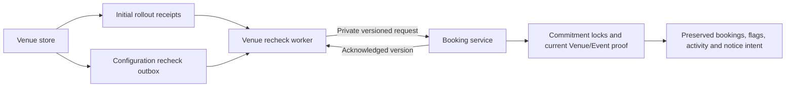

# Venue and booking model

Updated 13 October 2026 on `feat/aryan-sprint3-venue-safety`, after integrating main `52687d2`. Schemas and additive migrations below are the implementation source of truth. The files under `docs/erd` remain historical logical drafts. CS-74 still requires another developer's review; CS-77 owns the reviewed cross-service contract.

## Authoritative schemas

| Owner / database | Tables and new metadata | Additive migration |
| --- | --- | --- |
| Venue / `venue_db` | `venues`: setup/turnaround whole minutes and positive version; operating hours and immutable history; `venue_recheck_outbox` with unique venue/version intent, attempts and acknowledgement | [Buffers](../services/venue-service/prisma/migrations/20261012190000_venue_buffers/migration.sql), [durable rechecks](../services/venue-service/prisma/migrations/20261012194500_durable_venue_rechecks/migration.sql) |
| Booking / `booking_db` | Independent `venue_booking_requests`: version, expiry, per-room attendance/layout/needs, required marker, requirements fingerprint, immutable original-request fingerprint, venue version, buffer/window snapshot and conflict flags; activity ledger; `booking_outbox` with unique action key | [Checked holds and intent](../services/booking-service/prisma/migrations/20261012193000_checked_venue_holds/migration.sql) |
| Venue initial rollout / `venue_db` | `venue_buffer_rollouts`: unique local Venue receipt, captured version/intent, attempts/error, completion time/reason; cascades only when its local Venue is legitimately deleted | [Initial rollout](../services/venue-service/prisma/migrations/20261013204500_initial_buffer_rollout/migration.sql) |

Full definitions: [Venue schema](../services/venue-service/prisma/schema.prisma), [Booking schema](../services/booking-service/prisma/schema.prisma).

Venue, Event, manager and human actor UUID text identifiers are logical cross-service references, without cross-database foreign keys. Automated rollout uses an explicit service actor rather than impersonating a user. Local history/hour/outbox/rollout relationships remain in their owning database. Event service supplies the actual Event ID, Planning state, current Coordinator and requirements through its guarded, read-only planning-context route. Booking never reads `event_db` directly. The projection maps the existing form's known layout/accessibility labels to catalogue codes; unknown needs remain unmet.

## Persistence and concurrency

- Venue defaults existing buffers to zero and version to one. Existing IDs, hours and history are preserved. Venue and hours changes lock the Venue row, check a supplied version, increment it, and save history plus recheck intent in one transaction.
- Booking migration preserves IDs/statuses/history and records legacy advertised intervals as zero-buffer windows. Legacy tentative rows receive `min(createdAt + 72h, requestedStart)`; already elapsed deadlines are immediately ineffective. This migration uses the provisional 72-hour treatment; later new holds use configurable policy.
- Booking writes acquire ordered transaction-scoped PostgreSQL advisory locks for the Event and affected venues. They reread current records and use `clock_timestamp()` after waits and slow upstream checks. Successful changes save the booking, activity and unique outbox intent atomically. A failed intent insert rolls all three back.
- New ordinary requests are tentative holds. Staff decisions and extensions require the read version and a reason; stale or expired attempts have no effect. Ordinary creation cannot directly confirm a booking, including for a caller with both Coordinator and Venue Staff roles.
- Venue deletion is serialized through Booking's venue lock. It checks effective current/future tentative and confirmed occupied windows, then invokes Venue's private deletion endpoint with the checked configuration version while retaining the lock. Venue checks that version under its configuration row lock; concurrent buffer changes return409 for refresh/retry. Dependency failure fails closed. Historical rejected/cancelled and fully ended confirmed bookings remain readable after catalogue removal. Only an authorized unapproved move may tolerate a missing retired origin; destination checks remain strict.
- Venue configuration changes retain existing commitments. A durable private recheck retries unavailable Booking service and updates current timing/flags/history without cancelling an Event or another booking. Acknowledgement requires at least the source Venue version. This is eventual synchronization across databases; search, request, decision and readiness also check current Venue configuration.

No database exclusion constraint is claimed. Guarded writes supply conflict protection while permitting required operational closures and inherited conflict flags. Recheck/removal control routes under `/internal` are not routed through Kong. Catalogue/record proof routes also require the shared internal key; their `/venues` prefix does not itself confer public access.

## Current conflict and history projections

Initial buffer rollout is automatic after migration/server startup. Each poll
discovers at most100 legacy/imported venues under row locks with SKIP LOCKED,
persisting one receipt per Venue before any remote request. Configuration and
rollout queues share bounded20-action processing; lower-attempt work is considered
first so a failing dependency cannot starve later healthy venues. Failed intents
retain their action ID and retry after restart. Completion needs Booking's
acknowledgement of the captured or a newer version; it is not inbox delivery.

A newly created API Venue has a new random ID and no inherited commitments. Its
creation transaction records `NEW_VENUE_NO_INHERITED_COMMITMENTS` with zero attempts,
avoiding an extra rollout request beside its first configuration-change action.
Legacy/imported venues receive `BOOKING_ACKNOWLEDGED` only after the real recheck.
No startup pass rewrites Venue settings/history, deletes bookings, or changes the
Event lifecycle. The explicit service actor is `venue-buffer-rollout` / `SYSTEM`;
it grants no user role. Completed receipts prevent replay after restart.

Baseline consultation review: the authoritative Venue schema retains catalogue
type, capacity/layout/facilities/accessibility, local operating hours/timezone,
manager references and immutable local history. Calendar/operational commitments
remain in Booking; overlap and removal use current guarded interfaces. Week 7
buffer/version/hold/independent-room additions are additive and documented above.
No cross-database foreign key or second competing schema is introduced. Another
developer must still review this baseline comparison under CS-74, and CS-77 owns
the cross-service design review.

Venue Staff can read `/venue-bookings/conflicts` and explicitly recheck current
settings through `/venue-bookings/rechecks` with the read Venue version and a reason.
The authenticated actor owns the immutable activity; clients cannot supply another
actor. Current setup/turnaround windows determine both conflict panes and recheck
inclusion, including the period after advertised end but before turnaround ends.
Slow upstream reads finish before the final deadline projection. No read mutates
booking, history or outbox. Missing legacy Events are flagged without inventing an
Event or Coordinator; ordinary decisions still require authoritative Event proof.

Venue-specific history uses immutable before/after venue IDs. A move appears in
both involved timelines; creation remains at its origin. Snapshotless imported
activity is anchored to the earliest available immutable snapshot, with the current
venue retained only when no snapshot exists. The original activity payload is never
rewritten. The existing current-assignment booking-ID filter still protects history.

## Time, suitability and readiness

The occupied interval is advertised start minus Venue setup through advertised end plus turnaround. Operational closures already describe their occupied interval and are not expanded. Search, calendar and guarded writes use the same rule and deadline predicate; expired holds stop blocking immediately without waiting for a worker.

Search compares independent room attendance, parent minimum capacity where applicable, Venue type, layout, explicit facilities, mandatory accessibility and complete occupied-window opening hours. Full matches sort before eligible partial matches with named gaps. Search reserves nothing. Free-text venue notes remain visible for Staff assessment.

All non-cancelled required room arrangements must be approved for the current requirements and free of current suitability/conflict flags for `venueReady`. No capacities are summed and venue readiness does not confirm the parent Event. Physical/hybrid capacity remains positive; virtual capacity/layout may be inapplicable. Opening schedules still reject overnight hours; missing/closed days exclude the occupied interval. Human displays retain IANA timezones and API instants require explicit offsets.

## Remaining release boundaries

[Session 3 customer answers](session3-decisions.md) now resolve most policy. Exact buffer locking, Coordinator hold confirmation wording and numerical team choices remain in the [policy register](venue-policy-decisions.md). CS-50/51 must relay/consume booking intent and deliver actual notifications. CS-90 must integrate the expiry/reminder scheduler; the [PostgreSQL spike](hold-expiry.md) remains test-only.

Safety roles and technical/support readiness proof are not present on main. CS-10/42/77 and CS-93/94/95 must agree and deliver those boundaries before a full Safety queue or preparation transition. No empty equipment list is treated as proof of technical approval.

See [BFF routes](frontend-bff-venue-booking.md), [phase delivery and validation](devlogs/2026-10-13-venue-workflows.md), and the existing [Sprint 2 evidence](sprint2/evidence-log.md). This model update does not establish independent review, PO acceptance or story closure.

## Primary attendee location — Session 3 row26

`event_primary_venues` is owned by Booking: one row per Event, a restrictive foreign key to its booking, independent selection version, server actor and update time. The current assigned Coordinator selects an active room in Planning. Event/venue locks serialize selection with booking changes; selection and immutable `PRIMARY_VENUE_SELECTED` history commit atomically. Selection CAS and the read booking version reject stale actions. Other room status/version/approval records are unchanged.

The authenticated Event summary returns `primaryVenue` with booking ID, selection version and derived availability. Missing selection is version0. Release/expiry/flags retain the explicit choice for history but make it unavailable; there is no automatic fallback or cascade. The Attendee-facing Event projection is still a peer integration boundary and must require current confirmed/public lifecycle and an eligible primary room before publication.

## Confirmation buffer fence — Session 3 rows4/6

Venue owns nullable `buffersLockedAt`. Before a confirmed booking is committed, Booking requests an authenticated internal freeze with the Venue version it validated. The freeze and every buffer edit serialize on the Venue row; the fence increments the Venue version, records the Staff actor in immutable history, and returns the version used by Booking. An edit that wins first makes the freeze stale; a freeze that wins prevents later buffer edits. Unchanged buffers and unrelated venue maintenance remain permitted.

The additive migration conservatively freezes **existing venues**, because their confirmation history is owned by another service. This is temporary legacy protection, not an agreed customer policy for initial configuration. New venues freeze at a confirmation attempt; whether they must freeze at first setting instead remains the row4/row6 question in CS-76. No migration deletes bookings or history.

If acknowledgement is lost or the Booking transaction later fails, the Venue remains frozen. Retry approval after refreshing: the lock is idempotent at the current version and cannot silently unlock an uncertain commitment. The UI and error say only that buffers are locked, without claiming the Event/booking was confirmed. Administrative reconciliation of an abandoned attempt or legacy first configuration requires an agreed policy; no automatic unlock endpoint exists. The internal route is not exposed through Kong. Deploy both additive schemas and service versions together; old Booking versions cannot establish this fence for newly created venues.
